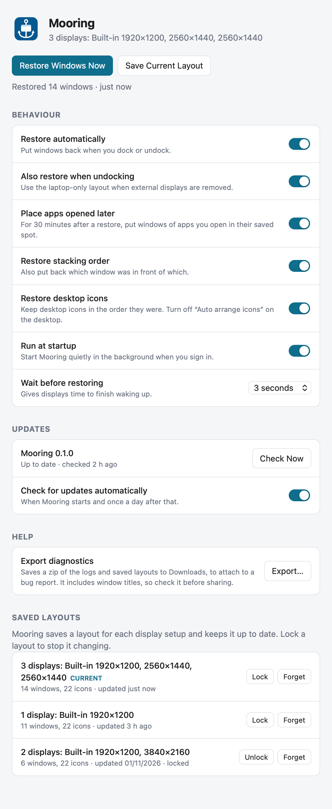

# Mooring

A boat moors at a dock and returns to the same spot, which is what your windows do when you redock.

Mooring is a free, open-source app for **Windows and macOS** that puts your windows back where they were when you plug your laptop into a dock or unplug it. On Windows it also puts desktop icons back in the order you left them.

> **Status: early development (v0.1, not yet released).** It has been tested on real docking setups on Windows and macOS. See the [Roadmap](#roadmap) for what's left before a first release. Help is very welcome; see [Contributing](#contributing).

## The problem

When you undock a laptop, the OS piles every window onto the laptop screen. When you dock again, they stay there, and you drag them back by hand. Windows 11 tries to remember positions, but it doesn't always work. macOS doesn't try at all.

## What Mooring does

- Runs in the system tray (Windows) or menu bar (macOS).
- Every few seconds, saves the position, size and state (normal, maximized or minimized) of every app window, filed under the current set of screens. Each display setup gets its own saved layout, such as "desk with two monitors", "laptop only" or "meeting room TV".
- When screens are added or removed, it stops saving, waits for them to settle, and moves every window back to where it was the last time you used that setup. Apps you open in the next half hour go back to their saved spot too.
- On Windows, it also saves and restores desktop icon positions.
- Lets you **lock** a layout so the automatic saving won't change it.
- Keeps itself up to date. It checks for a new version when it starts and once a day, and you can check any time from Settings or the tray menu. Updates install only when you click **Install and Restart**.
- Installs with a normal installer. On Windows you can install just for yourself (no admin rights) or for everyone (admin). It adds a Start menu entry and a desktop shortcut, and runs at startup. Startup can be turned off at any time.

<p align="center">
  <picture>
    <source media="(prefers-color-scheme: dark)" srcset="docs/images/settings-dark.png">
    
  </picture>
</p>

## Roadmap

### Before the first release

- [ ] **macOS signing:** sign and notarize the Mac build with an Apple Developer ID. Without it, Gatekeeper blocks the app. The release workflow is already wired for the secrets listed under [Releasing](#releasing).
- [ ] **Windows signing:** sign the Windows installer. Without it, SmartScreen shows a warning. The plan is to use [SignPath Foundation](https://signpath.org/), which signs open-source projects for free:
  - [ ] Apply to SignPath Foundation with this repo (needs multi-factor login on GitHub and SignPath).
  - [ ] Once approved, add SignPath's GitHub Action to the release workflow so it signs the Windows build.
  - Until then, Windows releases ship unsigned, and testers click **More info › Run anyway**.
- [ ] Publish the first release: tag `v0.1.0`, check the draft release, then publish it.

### Later

- [ ] **Linux** support (X11 first).

## Install

There's no release yet. Once there is, installers will be on the [Releases](https://github.com/OBL-Y/Mooring/releases) page.

### Windows

1. Run `Mooring_x.y.z_x64-setup.exe`.
2. If Windows asks whether to let the installer make changes, choose **Yes** to get a choice between **Only for me** (installs to `%LOCALAPPDATA%\Programs\Mooring`) and **Anyone who uses this computer** (installs to `C:\Program Files\Mooring`). If you choose **No**, or your account isn't an administrator, that page is skipped and Mooring installs just for you, with no admin rights needed. To install for everyone from a standard account, right-click the installer › **Run as administrator**.
3. On the last page, leave **Create desktop shortcut** ticked if you want one.

For a silent install, run the installer with `/S`.

To restore desktop icons, right-click the desktop › View and turn off **Auto arrange icons**. Otherwise Windows rearranges them itself.

### macOS

Needs macOS 13 (Ventura) or later.

1. Open `Mooring_x.y.z_universal.dmg` and drag Mooring to Applications.
2. Open Mooring. Until builds are notarized, macOS will say it can't check the app. Go to **System Settings › Privacy & Security**, scroll down, and click **Open Anyway**. You only need to do this once.
3. When asked, turn Mooring on under **System Settings › Privacy & Security › Accessibility**. Moving other apps' windows isn't possible without this.
4. Mooring sets itself to open at login, and macOS shows a notification saying a login item was added. If you've turned it off in **System Settings › General › Login Items & Extensions**, Mooring's Settings shows **macOS needs your OK** with a button that takes you there; turn Mooring on under **Allow in the Background**.

Mooring lives in the menu bar as an anchor icon. Closing its window doesn't quit it; use **Quit Mooring** from the icon's menu. If you can't see the icon, check **System Settings › Menu Bar**, and on MacBooks with a notch, make room by ⌘-dragging other icons out of the menu bar.

### Settings

Open Settings from the tray or menu bar icon, or launch Mooring again (for example from the desktop icon).

| Setting | Default | What it does |
| --- | --- | --- |
| Restore automatically | On | Put windows back when screens change. |
| Also restore when undocking | On | Also restore the laptop-only layout when screens are removed. |
| Restore stacking order | On (Windows), Off (macOS) | Also put back which window was in front of which. On a Mac each app comes forward briefly, so the screen may flicker. |
| Place apps opened later | On | For 30 minutes after a restore, put windows of apps you open in their saved spot (once each). |
| Restore desktop icons | On | Windows only. |
| Run at startup / Open at login | On | Start Mooring quietly when you sign in. |
| Wait before restoring | 3 s | Increase it if your dock is slow to wake its screens. |
| Check for updates automatically | On | Look for a new version at start-up and once a day. Mooring tells you when one is ready; it never installs without asking. |

### Known limits

- macOS doesn't let apps place desktop icons, so the icon option only exists on Windows.
- Full-screen macOS windows have their own Space, so Mooring leaves them alone.
- On Windows, windows of apps running as administrator can't be moved unless Mooring also runs as administrator.
- A window that was closed and reopened gets its old spot back only if its app and title (or its app) match what was saved.
- Updates come from full releases only. Beta (pre-release) builds don't update themselves; install the next beta by hand.
- Mac builds are signed with Mooring's own certificate, not yet an Apple Developer ID. macOS keeps Accessibility access across updates, but the first install needs **Open Anyway**.

## How it works

Mooring is a [Tauri 2](https://v2.tauri.app) app: a Rust back end, a small HTML/JS Settings window, and the system's own web view. That keeps installers to a few MB.

1. **Watch the screens.** Once a second, Mooring reads the list of connected screens and builds a fingerprint from each screen's hardware id and position. Each fingerprint is one "display setup".
2. **Save.** While the setup is unchanged, it saves every app window's position, size and state every 5 seconds. Windows are only written to disk when something actually moved.
3. **Notice a change.** When the fingerprint changes, saving stops immediately, so the windows the OS just shuffled don't overwrite the good layout.
4. **Restore.** After the settle delay, it matches saved windows to open windows: by window id first, then by app and title, then by app. It moves each one, waits a moment, and retries any that didn't land.

How each OS does it:

| | Windows | macOS |
| --- | --- | --- |
| Screens | `EnumDisplayMonitors`, with EDID-based ids from `EnumDisplayDevices` | `CGGetActiveDisplayList` |
| Reading and moving windows | `EnumWindows`, `GetWindowPlacement`, `SetWindowPlacement` | Accessibility API (`AXUIElement`) |
| Desktop icons | The desktop's `IFolderView` (shell COM) | Not possible |
| Run at login | Per-user `Run` registry key | LaunchAgent in `~/Library/LaunchAgents`, with its approval checked through `SMAppService` |
| Installer | NSIS (per-user or per-machine) | DMG |

### Project layout

```
src-tauri/
  src/
    lib.rs             App start-up, tray menu, commands used by the Settings window
    engine.rs          Watch / save / restore loop
    model.rs           Data types, display fingerprint, window matching (+ unit tests)
    store.rs           Saved layouts (layouts.json)
    settings.rs        Settings (settings.json)
    platform/
      windows.rs       Win32 + desktop icons
      macos.rs         CoreGraphics + Accessibility
  tauri.conf.json      App and installer configuration
  windows/hooks.nsh    Extra Windows installer/uninstaller steps
ui/                    Settings window (plain HTML, CSS, JS, no build step)
scripts/make-icon.swift  Draws the app and tray icons
scripts/screenshot.swift Renders the Settings screenshots in docs/images
.github/workflows/     CI (tests on both OSes) and Release (builds installers)
```

## Contributing

Bug reports, testing on your own dock setup, and pull requests are all welcome. The fastest way to help right now is to try Mooring with your own dock and open an issue with what happened.

[CONTRIBUTING.md](CONTRIBUTING.md) explains what to put in a bug report, how to set up the tools, run Mooring from source, and check your change before opening a pull request.

Everyone taking part is expected to follow the [Code of Conduct](CODE_OF_CONDUCT.md).

## Releasing

For maintainers:

1. Update the version in `package.json`, `src-tauri/Cargo.toml` and `src-tauri/tauri.conf.json`.
2. Commit, then tag and push: `git tag v0.1.0 && git push origin v0.1.0`.
3. The **Release** workflow builds the Windows installer and a universal macOS DMG and attaches them to a **draft** release.
4. Download and test both installers, then publish the release.

For test builds, use a tag with a suffix, such as `v0.1.0-beta.1`. These are published straight away as a **pre-release**, so testers can download the installers without signing in.

### Updates

Every release includes signed update files and a `latest.json`. The app checks `https://github.com/OBL-Y/Mooring/releases/latest/download/latest.json`, which GitHub points at the newest **published, non-pre-release** release. So publishing a release is what sends the update to everyone, and drafts and betas never do. The app only offers an update when that release's version number is higher than its own, so bump the version for every release.

The update files are signed with a private key that must be set as the repository secret `TAURI_SIGNING_PRIVATE_KEY` (with `TAURI_SIGNING_PRIVATE_KEY_PASSWORD` if the key has a password). Without it, the Release workflow fails. The matching public key is in `src-tauri/tauri.conf.json`. Keep a backup of the private key somewhere safe: if it's lost, existing installs can't be updated and people have to reinstall by hand.

Mac builds are signed with Mooring's own self-signed certificate ("Mooring Code Signing"), from the repository secrets `MAC_SIGNING_CERTIFICATE` (the `.p12` file, base64-encoded) and `MAC_SIGNING_CERTIFICATE_PASSWORD`. Because every build carries the same signature, macOS keeps Mooring's Accessibility and login-item approval when it updates. Keep a backup of the certificate: a new one means everyone has to allow Accessibility again once.

To sign and notarize with an Apple Developer ID instead (which also removes the **Open Anyway** step), add these repository secrets: `APPLE_CERTIFICATE`, `APPLE_CERTIFICATE_PASSWORD`, `APPLE_SIGNING_IDENTITY`, `APPLE_ID`, `APPLE_PASSWORD` and `APPLE_TEAM_ID`. For Windows signing, see the [Tauri Windows signing guide](https://v2.tauri.app/distribute/sign/windows/).

## License

[MIT](LICENSE) © 2026 OBL-Y
